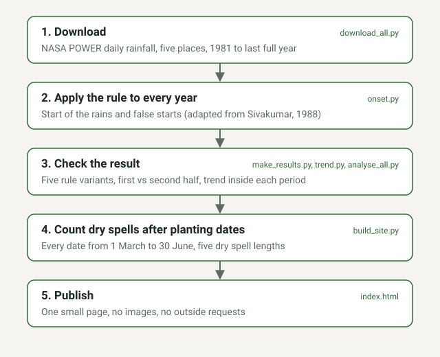

# When do the rains start in south-east Nigeria?

An open analysis of 44 years of daily rainfall for five places in south-east Nigeria (Enugu, Nsukka, Abakaliki, Onitsha and Owerri). It estimates when the rains usually start, how often an early wet spell is followed by a dry spell (a "false start"), and how risky it has been to plant on a given date.

**Live page:** https://kendrick-chinonso.github.io/southeast-nigeria-rain-onset/

**Author:** Nweke Precious Chinonso. This is a first agricultural technology data project, and a work in progress.



## The question

A farmer who plants after the first rains can lose seedlings if a dry spell follows. A farmer who waits too long loses part of the season. This project defines "the rains have started" with a written rule, applies it to every year, and shows how much the answer depends on that rule.

## The rule

For each year, starting from 1 March, the rains have started on the first day when:

- at least **20 mm** of rain has fallen over **3 days in a row**, and
- there is **no dry spell of 7 days or more** (days under 1 mm) in the **next 30 days**.

A **false start** means an earlier wet spell met the first condition but was followed by a dry spell of 7 days or more.

The rule is adapted from Sivakumar (1988), who studied drier parts of West Africa and, in the version I know, started looking in May. I apply it to a wetter zone and start on 1 March, so the numbers are a working choice, not an official standard for south-east Nigeria. I confirmed that the paper exists and that a slide deck from the African Centre of Meteorological Application for Development (ACMAD) attributes this rule to it. I have not read the paper's full text.

## What the page does

- **Check a planting date:** for any date from 1 March to 30 June and a dry spell length you choose, the share of years with such a dry spell in the next 30 days. It shows all years and the most recent 20 years side by side.
- **Best planting date:** an optimizer. You say how costly waiting a week is compared with losing a planting to a dry spell, and it picks the date with the lowest total loss, for all years and for the recent 20 years. It is a simple model of rainfall risk and waiting cost, not a crop model.
- **Step-change test:** a Pettitt test (Pettitt, 1979) with a permutation check finds the single biggest jump in the start date and says whether it could be chance. This separates a sudden change, which can point to a change in the data source, from a gradual trend.
- **Data checks:** every rebuild checks for missing days, negative values and unusual years, and stops if the data is unreliable.
- Pidgin and Igbo versions of the main text, share buttons for WhatsApp and SMS, and a yearly automatic update.

## What it found so far

These numbers come from the 1981 to 2024 run. The live page updates itself each year, so these may differ slightly from what you see there.

| Place | Median start | False starts | Later-half shift* |
|---|---|---|---|
| Owerri | 1 April | 27% | +19 days |
| Onitsha | 9 April | 32% | +21 days |
| Abakaliki | 9 April | 16% | +30 days |
| Enugu | 17 April | 18% | +21 days |
| Nsukka | 24 April | 18% | +24 days |

*Average start date in the second half of the record minus the first half.

For Enugu, the answer changes with the rule:

| Rule | Median start | False starts | Later-half shift |
|---|---|---|---|
| 20 mm in 3 days, 7-day dry spell (working rule) | 17 April | 18% | +21 days |
| 15 mm in 3 days | 3 April | 27% | +17 days |
| 25 mm in 3 days | 22 April | 9% | +23 days |
| 5-day dry spell | 23 April | 36% | +24 days |
| 10-day dry spell | 4 April | 5% | +21 days |

- The median start moves by about three weeks depending on the rule, and the false start rate ranges from 5% to 36%. A false start percentage means nothing without its rule.
- At every place and under every rule tried for Enugu, the second half of the record starts later than the first half, by 17 to 30 days.
- For Enugu, the trend is +0.99 days per year over 1981 to 2024 (chance of a trend this large by luck: 0.001). Inside the two halves it is +1.49 days per year for 1981 to 2000 (0.128, only 20 years) and +1.65 days per year for 2001 to 2024 (0.019). I ran this check only for Enugu.

### A sudden jump, and a matching fall in yearly rain

A step-change test (Pettitt, 1979, with a permutation check) finds the biggest single jump in the start date at each place. Yearly rainfall in the same dataset also falls between the first and second half of the record.

| Place | Biggest jump in start date | Average start before and after | Chance of a jump this big by luck | Yearly rain, first to second half |
|---|---|---|---|---|
| Enugu | 2006/2007 | 6 Apr to 2 May (+25 days) | 0.7% | 1801 to 1446 mm (-20%) |
| Nsukka | 1998/1999 | 8 Apr to 4 May (+26 days) | 1.9% | 1618 to 1311 mm (-19%) |
| Abakaliki | 1999/2000 | 26 Mar to 26 Apr (+30 days) | 0.1% | 1732 to 1378 mm (-20%) |
| Onitsha | 1997/1998 | 27 Mar to 22 Apr (+26 days) | 0.3% | 2100 to 1707 mm (-19%) |
| Owerri | 1997/1998 | 22 Mar to 14 Apr (+23 days) | 1.1% | 2275 to 1869 mm (-18%) |

- At all five places the jump is unlikely to be luck within this dataset. For four of them it falls between 1997 and 2000.
- A step and a straight-line trend explain about the same share of the variation (Enugu: 23.5% and 23.8%), so this test cannot say whether the change was sudden or gradual.
- Yearly rainfall falls by 18 to 20% at all five places over the same period. A change this large and this simultaneous could be a real change in climate. It could also come from a change in how the rainfall product is made. This dataset cannot tell the two apart, so **the later start is unconfirmed until it is checked against a second source.**

### Second-source check (ERA5)

I compared NASA POWER with ERA5, a weather reanalysis from the European Centre for Medium-Range Weather Forecasts (ECMWF), downloaded through the free Open-Meteo archive (`download_era5.py`, `compare_sources.py`). ERA5 is made with a different model, so agreement would be meaningful. It is still a model, not rain gauges, and its grid is about 25 km. Years compared: 1981 to 2024.

| Place | Later-half shift: NASA / ERA5 | Trend (days per year): NASA / ERA5 | Yearly rain change: NASA / ERA5 | Daily correlation | Yearly-total correlation |
|---|---|---|---|---|---|
| Enugu | +21 / +3 days | +0.99 / +0.18 | -20% / -6% | 0.37 | 0.06 |
| Nsukka | +24 / +8 days | +0.89 / +0.34 | -19% / -6% | 0.38 | 0.05 |
| Abakaliki | +30 / +5 days | +1.37 / +0.23 | -20% / -4% | 0.35 | 0.03 |
| Onitsha | +21 / +13 days | +0.68 / +0.50 | -19% / -3% | 0.32 | 0.00 |
| Owerri | +19 / +5 days | +0.65 / +0.11 | -18% / -3% | 0.35 | -0.09 |

- **Direction agrees, size does not.** ERA5 also shows a later start at all five places, but by 3 to 13 days, not 19 to 30. Its step-change tests are not significant (p from 0.15 to 0.92).
- **The fall in yearly rain appears only in NASA POWER.** ERA5 shows a fall of 3 to 6%, which is small and not significant.
- **The two sources agree weakly.** Day-by-day correlation is about 0.35. Correlation of yearly totals is close to zero, so they do not agree on which years were wet or dry. Average yearly rain also differs a lot at some places (Onitsha: 1903 mm in NASA, 1213 mm in ERA5).
- **What this means:** the later start is **not confirmed**. At least one of the two products does not track real year-to-year rainfall well here. This check cannot say which. As far as I know, reanalyses like ERA5 are weak for tropical rainfall, so a gauge-based source is the proper next test.

## Limits

- The rainfall values are **satellite and model estimates** (NASA POWER) for a grid cell of roughly 50 km. They are not rain gauge readings from a farm.
- All five places use the **same rainfall product**, so they are not five independent confirmations. A problem in the product itself could produce the same pattern everywhere.
- The later start, and the fall in yearly rain that comes with it, are patterns in NASA POWER. **A first check against a second source (ERA5, below) did not reproduce them at the same size, so they are unconfirmed and should not be reported as a change in the climate.** A gauge-based source such as CHIRPS, or station records, is still needed.
- The planting-date tool looks at rainfall only. It ignores soil, crop, seed and farm practice, so it is **not planting advice** for a particular farm.
- The planting-date tool and the step-change test use NASA POWER only. The two sources agree weakly (see below), so treat the risk numbers as indicative, not exact.
- The Pidgin and Igbo versions of the page are drafts and have not been checked by a fluent speaker.
- Past patterns do not guarantee future seasons.

## Run it yourself

You need Python 3 with `pandas`, `numpy` and `requests`.

```
pip install pandas numpy requests
python test_onset.py     # checks that the rule behaves as described
python test_new.py       # checks the step-change test, optimizer and data checks
python download_all.py   # downloads daily rainfall for the five places
python check_data.py     # quality checks on the downloaded files
python build_site.py     # computes everything and writes index.html
```

Open `index.html` in a browser. The `rain_*.csv` files are included, so you can skip the download step.

## Files

| File | What it does |
|---|---|
| `onset.py` | The rule: start of the rains and false starts for each year |
| `test_onset.py` | Seven checks on the rule (false start, no rain, rain before March, 6 vs 7 dry days) |
| `download_all.py` | Downloads daily rainfall from NASA POWER, with retries |
| `changepoint.py` | Pettitt step-change test with a permutation check |
| `optimize.py` | The planting-date optimizer (the page repeats it in JavaScript) |
| `check_data.py` | Data quality checks |
| `test_new.py` | Tests for the three files above |
| `download_era5.py`, `compare_sources.py`, `test_sources.py` | Second-source check against ERA5 |
| `net_test.py` | Shows which data servers your connection can reach |
| `analyse_all.py` | Runs the rule at each place and summarises the results |
| `build_site.py`, `template.html` | Compute dry spell risk for planting dates and build the single-file page `index.html` |
| `.github/workflows/update.yml` | Re-runs everything every February with the latest year of data |

## Data and references

Daily precipitation (`PRECTOTCORR`) from the NASA Langley Research Center (LaRC) POWER Project, https://power.larc.nasa.gov/. Check the POWER site for its current wording on how to acknowledge the data.

Pettitt, A. N. (1979). A non-parametric approach to the change-point problem. *Journal of the Royal Statistical Society, Series C (Applied Statistics), 28*(2), 126-135.

Sivakumar, M. V. K. (1988). Predicting rainy season potential from the onset of rains in southern Sahelian and Sudanian climatic zones of West Africa. *Agricultural and Forest Meteorology, 42*(4), 295-305.

## Planned

- Check against a gauge-based source (CHIRPS, or station records). CHIRPS from NOAA's server could not be reached from my connection, and CHIRPS's own server needs large downloads.
- Show both rainfall products on the page, so the planting-date advice reflects how much the sources disagree.
- Crop-specific dry spell limits, once reliable sources are found.
- Checks of the Pidgin and Igbo text by fluent speakers.
